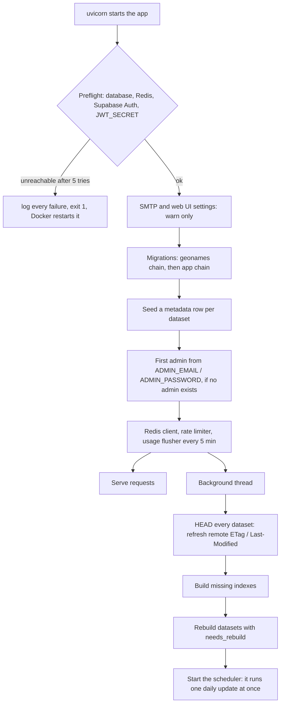
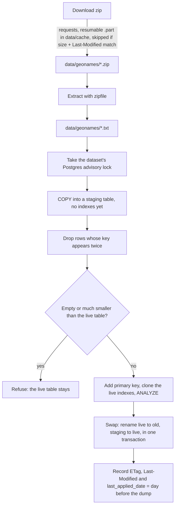
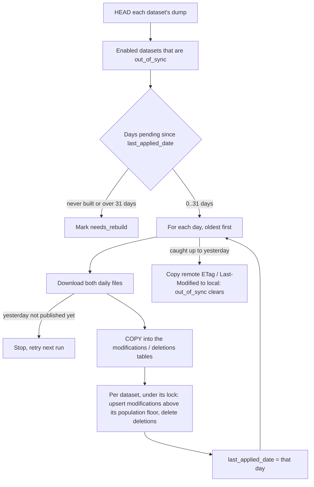
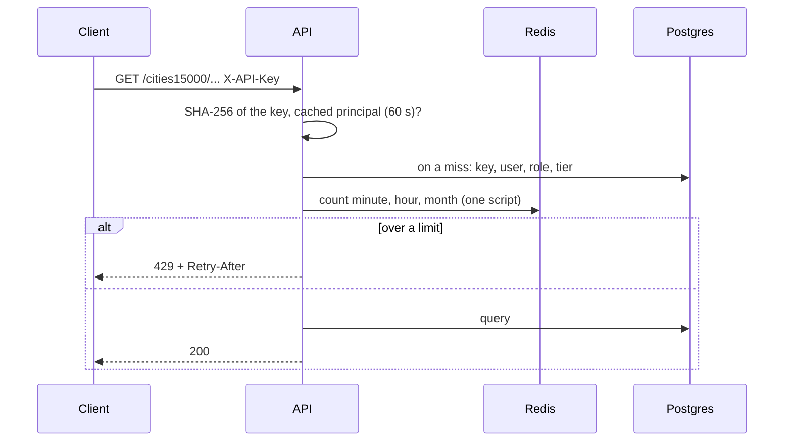

# Developing geonames-server

Everything runs inside the dev container: never run `uv`, `pytest` or the app on the host. For what the server is and how users deploy it, see the [project README](../README.md).

## Get started

1. Open the repository in VS Code → **Dev Containers: Reopen in Container**. It starts the services below, runs `uv sync` (with the dev and test groups) and `npm ci` for the web UI, and seeds the dev users on every start.
2. `make switch2dev`: copies `.env.dev` to `.env` (dev settings; downloads come from the local `slow-download-server`).
3. `make seed-users`: creates the dev users. Later starts do it automatically; the first one had no `.env` yet.
4. `make download-datasets`: fills `gostatic/` from geonames.org, so the app has something to download. Once.
5. `make run`: builds the web UI, then starts the API on http://localhost:9500 (UI at `/ui`, docs at `/docs`).
6. Log in at http://localhost:9500/ui as `admin@geonames.local` / `dev-password`.
7. Optional: `make ui-dev` for the web UI with hot reload at http://localhost:5173/ui/.
8. Tests: create the throwaway database once (`psql -h db -U postgres -c "create database geonames_test"`), then `make tests-pg` (Python) and `make ui-test` (web UI).

## Services

| Service | URL | Purpose |
|---|---|---|
| app | http://localhost:9500 | The dev container: run the API here. Python 3.12, uv, Node 24, Docker CLI |
| app (Vite) | http://localhost:5173/ui/ | Web UI dev server (`make ui-dev`) |
| db | localhost:5432 | Supabase Postgres 17: geonames data, user data, Supabase auth. User `postgres`, database `postgres` |
| kong | http://localhost:8000 | Gateway: Studio at `/` (basic auth `DASHBOARD_USERNAME` / `DASHBOARD_PASSWORD`), Auth API at `/auth/v1` |
| auth, studio, meta | via kong | Supabase Auth (GoTrue), Studio and its Postgres metadata API |
| mailpit | http://localhost:8025 | Catches every email Supabase Auth sends; nothing is delivered |
| redis | localhost:6379 | Rate-limit counters |
| pgadmin | http://localhost:5050 | Postgres admin UI |
| slow-download-server | http://localhost:3003 | nginx serving `gostatic/` at a set speed, standing in for geonames.org |
| gostatic | http://localhost:3002 | The same files, unthrottled |

All secrets in `.devcontainer/.env` and `.env.dev` are throwaway dev values.

## Repository layout

| Path | What |
|---|---|
| `src/geonames_server/api/` | FastAPI app: routers, auth, rate limiting, preflight, first admin |
| `src/geonames_server/ingestion/` | Download, extract, load, daily updates, scheduler |
| `src/geonames_server/database/` | SQLAlchemy models, repositories, sessions, migration runner |
| `src/geonames_server/config/` | Settings (pydantic-settings, from `.env`) |
| `src/geonames_server/log/`, `rich_console/`, `logger_config/` | Logging and Rich progress bars |
| `src/geonames_server/scripts/` | Dev tools (seeders, stress, OpenAPI, compose generator) and `supabase_keys` (the only one in the image) |
| `migrations/`, `migrations/app/` | Alembic chains: geonames tables, and user data (`app` schema) |
| `frontend/` | Web UI: React, Vite, Tailwind, shadcn |
| `supabase/` | Trimmed Supabase stack: services, Kong routes, db init scripts |
| `deploy/` | Template of the deployment's `docker-compose.yml` |
| `tests/` | pytest suite (`*_pg.py` need Postgres) |

## How it works

### Startup



`/health` reports progress (`datasets.startup`, `ready`, `pending`); a dataset's routes answer `503` with `Retry-After` until its first build.

### Sync state

Each dataset has a row in `dataset_metadata` with the local and remote `etag` / `last_modified`. Two flags are computed whenever it changes:

- `out_of_sync`: ETags differ, the remote is newer, or a value is missing. The daily update catches these up.
- `needs_rebuild`: never built, or the remote dump is 2+ days newer than the local copy. These get a full rebuild.

### Building a dataset



The live table keeps serving during the load; only the final renames take a brief lock. psycopg2 runs the COPY and the swap.

### Daily updates

GeoNames publishes `modifications-YYYY-MM-DD.txt` and `deletes-YYYY-MM-DD.txt` for the previous day. They run at `SYNC_SCHEDULE_HOURS` (UTC), once at startup, and on `POST /sync/` (admins).



Population floors: `cities500` ≥ 500, `cities1000` ≥ 1,000, `cities5000` ≥ 5,000, `cities15000` ≥ 15,000; `allcountries` takes every row. Applying a day is idempotent, so replays are safe.

### Requests



- **Login** (web UI): the browser talks to Supabase Auth through Kong and sends its token to `/portal` (keys, usage, profile, `/portal/admin`).
- **API keys**: only the SHA-256 is stored; the key is shown once.

### Rate limiting

- **One check:** a single Redis script counts the request in the user's minute, hour and month windows and refuses it if any is full. `429` carries `Retry-After`: the seconds until the longest-blocked window resets.
- **What counts:** every request on the data routes, `/modifications`, `/deletions`, `/metadata` and `/sync` that passes the key check, whatever its status (`404`, `422`, building `503`). Not counted: `429`s, unknown keys, a non-admin's refused `/sync`, `/portal`, `/health`. Unlimited tiers are counted, never refused.
- **Fixed windows:** counters reset at the start of each UTC minute, hour and month, so up to twice the minute limit fits across a minute boundary.
- **Flush:** every `USAGE_FLUSH_SECONDS` (300) the counts per key and hour go to `app.api_key_usage`, with each key's `last_used_at`. `/portal/usage`'s daily and per-key numbers come from there.
- **Redis lost its data:** each user's hour and month counters are rebuilt from `app.api_key_usage` on their next request; at most the last flush interval is lost. Redis also appends to disk every second.
- **Redis down:** counting and limiting continue in the app's memory, starting from each user's stored usage; the counts still reach Postgres, and are added to Redis when it is back. `/health` reports Redis `error`.
  - Requests in flight when Redis fails wait up to 1 s; after that one request retries Redis every 30 s while the rest stay in memory.
  - A request whose Redis reply times out (slow, not gone) passes uncounted, as Redis most likely counted it.
  - A failed counter rebuild (Postgres down too) is counted in memory and flushed later.
  - In-memory counts die with the process: stopping while Postgres is also down loses them (the shutdown warning says how many).
- **No `REDIS_URL`:** nothing is limited or counted; preflight warns.
- **Key cache:** a key's user, role and tier are cached for `AUTH_CACHE_SECONDS` (60), so Studio edits apply within a minute; revoking through `/portal` drops the key at once. One app instance only: a second would have its own cache and memory counters.

### Libraries

| Library | Used for |
|---|---|
| FastAPI, uvicorn (+ uvloop, httptools) | The API and its server |
| pydantic, pydantic-settings, python-dotenv | Request/response models; settings from `.env` |
| SQLAlchemy + psycopg 3 | ORM, repositories, sync and async sessions |
| psycopg2 | Bulk `COPY` loads, index builds, table swaps |
| Alembic | The two migration chains |
| requests | Dataset and daily-file downloads, HEAD checks |
| httpx | Supabase Auth admin API (creating users), preflight |
| APScheduler | Daily update jobs |
| redis-py | Rate-limit counters |
| PyJWT | Checking Supabase login tokens; service tokens for the Auth admin API |
| Rich | Console logging (`RichHandler`: colours, tracebacks with locals); progress bars for download, extraction and ingestion (`rich_console/`); debug tables and tracing decorators (`rich_console.py`) |
| zipfile, smtplib, tomllib (stdlib) | Extraction, the SMTP check, reading the version from `pyproject.toml` |
| React, Vite, Tailwind, shadcn/Radix, TanStack Query, supabase-js, Recharts, Sonner | The web UI: pages, build, styling, components, data fetching, login, charts, toasts |

Logs go to the console through Rich, at `LOG_LEVEL`; errors also go to `logs/geonames.jsonl` as JSON lines.

## Dev users

Every container start runs `make seed-users`: four confirmed users with password `dev-password`, one per tier, each with an API key from `.env.dev`. It needs `DEV_SEED_USERS=true` (only `.env.dev` sets it).

| User | Role / tier | API key in `.env` |
|---|---|---|
| `free@geonames.local` | free / basic | `DEV_API_KEY_FREE` |
| `tester@geonames.local` | tester / plus | `DEV_API_KEY_TESTER` |
| `dev@geonames.local` | dev / pro | `DEV_API_KEY_DEV` |
| `admin@geonames.local` | admin / max (can `/sync`) | `DEV_API_KEY_ADMIN` |

Also `alice@` (free) and `bob@geonames.local` (dev), without keys, to change freely on the Administration page; they are never reset.

```sh
KEY=$(sed -n 's/^DEV_API_KEY_FREE *= *//p' .env)
curl -H "X-API-Key: $KEY" "http://localhost:9500/cities15000/?limit=5"
```

## Make commands

`make help` prints them all. `ROLE=free,dev` picks seeded users and `ARGS="..."` passes options to the script behind a target.

| Command | What it does |
|---|---|
| **Help** | |
| `make help` | List the targets |
| `make status` | Project name and version |
| **Environment** | |
| `make switch2dev` / `make switch2prod` | Copy `.env.dev` / `.env.prod` to `.env` |
| `make supabase-keys` | Print fresh Supabase secrets for a `.env` |
| **Dependencies** | |
| `make sync` / `make sync-dev` | `uv sync` (with the dev and test groups) |
| `make add` / `make add-dev` | `uv add` a runtime / dev dependency |
| `make lock` | Update `uv.lock` |
| `make requirements` | Export runtime-only `requirements.txt` from `uv.lock` (what the image installs) |
| `make init` | Initialise a uv project |
| **Development** | |
| `make run` | Build the web UI, start the API on 9500 |
| `make build` | Run the tests, then build the package |
| `make tests` | pytest; `*_pg.py` and Redis tests skip without a database |
| `make tests-pg` | All tests, against `geonames_test` and Redis database 15 |
| `make lint` / `make lint-check` | ruff check, with / without fixes |
| `make format` / `make format-check` | ruff format, writing / checking |
| `make lock-check` | `uv.lock` matches `pyproject.toml` |
| `make requirements-check` | `requirements.txt` matches `uv.lock` |
| `make openapi` / `make openapi-check` | Regenerate / check `openapi.yaml` |
| `make deploy-compose` / `make deploy-compose-check` | Regenerate / check the single-file `docker-compose.yml` |
| `make predeploy` | Every check: the above, all tests, the web UI's lint, tests and types |
| `make clean` | Remove caches and build output |
| **Web UI** | |
| `make ui-install` | `npm ci` |
| `make ui-dev` | Vite dev server on 5173 (proxies the API on 9500) |
| `make ui-build` | Build into `frontend/dist` |
| `make ui-lint` | ESLint and type check |
| `make ui-test` | Vitest, once |
| `make ui-types` / `make ui-types-check` | Regenerate / check the UI's API types from `openapi.yaml` |
| **Database** | |
| `make db-upgrade` / `make db-downgrade` | Apply all / roll back one geonames migration |
| `make db-revision` / `make db-auto-revision` | New empty / autogenerated geonames migration (`MESSAGE="..."`) |
| `make db-app-upgrade` / `make db-app-downgrade` / `make db-app-revision` / `make db-app-auto-revision` | The same for the `app` schema (user data) |
| **Dev users and load** (API running) | |
| `make seed-users` | Create or restore the dev users and keys |
| `make check-keys` / `make check-key-free` (`-tester`, `-dev`, `-admin`) | Call the API with the dev keys: ok, rejected or unreachable |
| `make api-call` | Calls as the seeded users (`ARGS=--portal` shows their tier and usage) |
| `make stress` | Concurrent load as the seeded users; latency and status per role |
| `make stress-limits` | Hit each tier's minute limit for real; `LIMIT=1` hour, `QUOTA=1` month |
| `make reset-usage` | Reset the seeded users' counters (`LIMIT=1`, `QUOTA=1`, `MINUTE=1`) |
| **GeoNames data** | |
| `make download-datasets` | Fill `gostatic/` from geonames.org (`DATASETS=cities15000,... DAILY=yes`, `GEONAMES_DUMP_URL=` for a mirror) |
| `make download-speed` | Set slow-download-server's speed (`RATE=2m`, `0` = unlimited) |
| `make remote-etag` | Show the remote files' ETag and Last-Modified |
| **Docker image** | |
| `make prebuild` | Regenerate `requirements.txt` and `docker-compose.yml`, then ruff, `uv lock --check`, `openapi-check`, UI lint |
| `make build-image` / `make build-image-version` | `prebuild`, then build `:<version>` (and tag `:latest`) |
| `make image-check` | Build, then check: imports, version, one migration head per chain, UI built in, no tests or dev scripts |
| `make push-image` / `make push-image-version` | `image-check`, then push to ghcr |
| **GitHub** | |
| `make gh-auth` / `make git-auth` | Check `gh` and git push access as `neo7dev` |

## Simulated downloads

`.env.dev` points `GEONAMES_URL` at `slow-download-server`, which serves `gostatic/` at `limit_rate` from `.devcontainer/nginx.conf` (default `10m`/s; reloads within 2 s). The app downloads from it into `data/geonames/` exactly as from geonames.org. Lower the speed (`make download-speed RATE=500k`) to test retries and resume. To use geonames.org instead, set `GEONAMES_URL = "https://download.geonames.org/export/dump/"` in `.env`.

## Release

1. Bump `version` in `pyproject.toml`: the app version and the image tag. Then `make openapi` (the spec carries it).
2. `make predeploy`.
3. `make image-check`: runs `prebuild`, builds on the host's Docker, checks the image.
4. `make push-image`.

The image installs `requirements.txt` with pip: runtime packages only, no uv, tests or dev scripts. `docker-compose.yml` in the repo root is generated (`make deploy-compose`) from `deploy/docker-compose.template.yml` and `supabase/`, with Supabase's config files inlined; edit those, never the generated file. The deploy stack runs on the host (`docker compose up -d`): from the container, compose would hand the host `/workspace/...` paths it does not have.

## Container setup notes

- **GitHub:** the container pushes as `neo7dev` with `~/.ssh/neo7_github` (or `GEONAMES_SSH_KEY`), mounted read-only; the host's ssh-agent signs. `gh` gets `GH_TOKEN` from `GEONAMES_GH_TOKEN`. After changing either, fully quit and relaunch VS Code.
- **Timezone:** the app container gets `TZ` from the host's `HOST_TZ` (exported for VS Code by `~/.zsh/host/*.zsh`), so log times match your clock. Unset: UTC. A change needs a container rebuild.
- **Docker:** the `docker-outside-of-docker` feature gives the container the host's Docker socket, and with it full control of the host's Docker.
- **OAuth (optional):** create a GitHub or Google OAuth app with callback `http://localhost:8000/auth/v1/callback`, put its id and secret in `.devcontainer/.env`, set `GITHUB_ENABLED` / `GOOGLE_ENABLED=true`, recreate `auth`.
- **Resetting Supabase:** its init scripts only run on an empty data directory. Remove the `supabase-db-data` and `supabase-db-config` volumes to start over.
