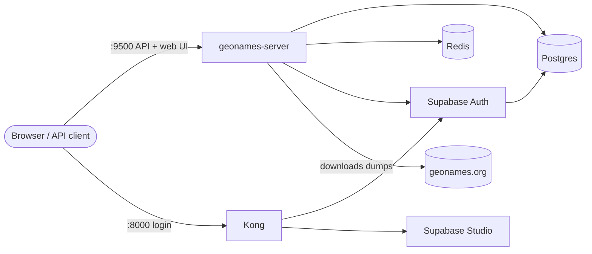

# GeoNames Server

A self-hosted REST API for [GeoNames](https://www.geonames.org) place data. It downloads the GeoNames dumps into PostgreSQL, keeps them current with GeoNames' daily updates, and serves them to users with API keys, per-user rate limits and a web UI.

Developing on it? See [.devcontainer/README.md](.devcontainer/README.md).

## How it works



- **Data:** on first start the server downloads each enabled dataset from geonames.org, loads it into Postgres and serves it. Every day it applies GeoNames' modifications and deletions; a dataset that falls too far behind is rebuilt from a fresh dump.
- **Accounts:** users sign up in the web UI (Supabase Auth), create API keys, and see their usage. Admins manage users on the Administration page, and its **Activity** tab logs every account change: signups, accounts created, upgrades and downgrades, name and email changes, deactivation, deletion, restoring, suspension and removal, with who did it and when.
- **Limits:** each user's role maps to a tier with per-minute, per-hour and per-month limits, counted in Redis.

### Datasets

| Key            | Contents                                                           |
| -------------- | ------------------------------------------------------------------ |
| `allcountries` | Every place in GeoNames (~13M rows, ~420 MB zipped)                |
| `cities500`    | Cities with population > 500, or seats of administrative divisions |
| `cities1000`   | Cities with population > 1,000                                     |
| `cities5000`   | Cities with population > 5,000                                     |
| `cities15000`  | Cities with population > 15,000 (~34k rows)                        |

`ENABLED_DATASETS` picks which ones to load (default: all).

## Getting started

Needs Docker with Compose v2. `docker-compose.yml` is the whole deployment in one file (app, Redis, Supabase); nothing else from this repository is needed.

```bash
mkdir geonames && cd geonames

# 1. Get the compose file
curl -fsSLO https://raw.githubusercontent.com/neo7dev/geonames/main/docker-compose.yml

# 2. Generate the secrets into .env (once: the keys are signed with that run's JWT_SECRET)
docker run --rm --entrypoint python ghcr.io/neo7dev/geonames-server \
  -m geonames_server.scripts.supabase_keys > .env

# 3. Add the first admin login to .env
echo "ADMIN_EMAIL = you@example.com" >> .env
echo "ADMIN_PASSWORD = a-strong-password" >> .env

# 4. Start everything
docker compose up -d
```

5. Open http://localhost:9500/ui and log in as the admin. Create an API key on **API keys**.
6. Wait for the data: `curl http://localhost:9500/health` shows `datasets.ready`. Until a dataset is ready its endpoints answer `503` with `Retry-After`.
7. Call the API: `curl -H "X-API-Key: $KEY" "http://localhost:9500/cities15000/?limit=5"`

On a server, before step 4, also set in `.env`:
- `SUPABASE_PUBLIC_URL`: Kong's public address (e.g. `https://auth.example.com`)
- `API_EXTERNAL_URL`: `SUPABASE_PUBLIC_URL` + `/auth/v1`
- `SITE_URL`: the web UI's public address, ending in `/ui/`
- TLS: put your own reverse proxy (Caddy, nginx, Traefik) in front of ports 9500 and 8000.

After the first start, remove `ADMIN_PASSWORD` from `.env`; it is only read while no admin exists.

### Operating it

| Task                                             | Command                                       |
| ------------------------------------------------ | --------------------------------------------- |
| Follow the logs                                  | `docker compose logs -f app`                  |
| Update to a new image                            | `docker compose pull && docker compose up -d` |
| Stop                                             | `docker compose down`                         |
| Stop and delete all data (users, keys, datasets) | `docker compose down -v`                      |

- **Startup checks:** the server checks the database, Redis and Supabase Auth before anything else. If one is unreachable it logs `Preflight failed: ...` and exits, and Docker restarts it.
- **Email (optional):** set `SMTP_HOST`, `SMTP_PORT`, `SMTP_USER`, `SMTP_PASS` and `SMTP_ADMIN_EMAIL` for signup confirmation and password resets. Without SMTP everything else works: the server warns at startup, and the web UI tells users when an email feature is unavailable. Then set `DISABLE_SIGNUP=true` and create accounts on the Administration page.
- **One instance only:** run a single `app` container. The scheduler and the key cache live in the process.
- **Ports:** `APP_PORT` (9500) and `KONG_HTTP_PORT` (8000) move them.

## Using the API

1. Get an API key: web UI → **API keys** → **Create**. It is shown once.
2. Send it on every data request: `X-API-Key: <key>`. Without a valid key: `401`.
3. Stay within your tier's limits. Over a limit: `429` with `Retry-After` (seconds).

| Endpoint                                       | What it does                                                                                            |
| ---------------------------------------------- | ------------------------------------------------------------------------------------------------------- |
| `GET /<dataset>/`                              | Paged list (`limit`, `offset`)                                                                          |
| `GET /<dataset>/filter`                        | Filter by name, country, admin codes, feature class/code, population range, timezone, dates; `order_by` |
| `GET /<dataset>/{geonameid}`                   | One place                                                                                               |
| `GET /modifications/...`, `GET /deletions/...` | The daily changes GeoNames published                                                                    |
| `GET /metadata/...`                            | Each dataset's sync state                                                                               |
| `POST /sync/`, `GET /sync/{id}`                | Run the daily update now and follow it (admins only)                                                    |
| `GET /health`                                  | Status, version, datasets ready (no key needed)                                                         |

```bash
curl -H "X-API-Key: $KEY" \
  "http://localhost:9500/cities15000/filter?country_code=US&min_population=1000000&order_by=-population&limit=20"
```

Over a limit:

```
HTTP/1.1 429 Too Many Requests
Retry-After: 34

{"detail": "Rate limit exceeded: 10 requests per minute on the basic tier"}
```

### Without the web UI

Get a key from the command line. `ANON_KEY` is in `.env`; Kong requires it on the Auth API.

```bash
# 1. Sign up, then follow the link in the confirmation email (skip with ENABLE_EMAIL_AUTOCONFIRM=true)
curl -X POST http://localhost:8000/auth/v1/signup -H "apikey: $ANON_KEY" \
  -H "Content-Type: application/json" -d '{"email": "you@example.com", "password": "..."}'

# 2. Log in: the response's access_token is the login token (valid for JWT_EXPIRY seconds, 3600)
curl -X POST "http://localhost:8000/auth/v1/token?grant_type=password" -H "apikey: $ANON_KEY" \
  -H "Content-Type: application/json" -d '{"email": "you@example.com", "password": "..."}'

# 3. Create an API key: the response's "key" is shown only this once
curl -X POST http://localhost:9500/portal/keys -H "Authorization: Bearer $ACCESS_TOKEN" \
  -H "Content-Type: application/json" -d '{"name": "laptop"}'
```

### Portal endpoints

What the web UI uses; they take the login token (`Authorization: Bearer ...`), not an API key.

| Endpoint                                     | What it does                                                                                                                  |
| -------------------------------------------- | ----------------------------------------------------------------------------------------------------------------------------- |
| `GET /portal/me`                             | Email, name, role, tier, limits, active key count                                                                             |
| `PATCH /portal/me`                           | Change your display name                                                                                                      |
| `GET /portal/keys`                           | Your active keys (name, prefix, created, last used); never the key itself                                                     |
| `POST /portal/keys`                          | Create a key (`{"name": "..."}`, 1-64 characters): `201` with the key, `409` at the tier's key limit                          |
| `POST /portal/keys/{id}/roll`                | Replace a key with a new one of the same name                                                                                 |
| `DELETE /portal/keys/{id}`                   | Revoke a key; it stops working at once                                                                                        |
| `GET /portal/usage?days=30`                  | Current minute, hour and month against the limits (live), requests per UTC day (1-90 days), and this month's requests per key |
| `/portal/admin/users`, `/portal/admin/roles` | Administration page (admins): list, create, edit, deactivate, delete and restore users                                        |
| `GET /portal/admin/events`                   | Account log (admins): what happened to accounts and who did it, newest first; filter by `user_id`, `event`, `q` (email)       |

### OpenAPI spec

- Interactive docs: http://localhost:9500/docs (Swagger UI; **Authorize** with your key) and `/redoc`
- Live spec: `GET /openapi.json`
- In the repository: [`openapi.yaml`](openapi.yaml), generated from the app (`make openapi`; `make openapi-check` fails while it is stale)

### Tiers

| Tier  | Roles                      | /minute   | /hour     | /month (UTC) | API keys  |
| ----- | -------------------------- | --------- | --------- | ------------ | --------- |
| basic | free (default for signups) | 10        | 100       | 5,000        | 1         |
| plus  | tester                     | 30        | 500       | 50,000       | 3         |
| pro   | dev                        | 120       | 2,500     | 500,000      | 5         |
| max   | sr_dev, admin              | unlimited | unlimited | unlimited    | unlimited |

All of a user's keys share one set of limits. Windows reset at the start of each UTC minute, hour and month.

- **Changing plans:** admins change a user's role on the Administration page. Tiers, roles and which role new signups get (`is_default`) are rows in Supabase Studio (`app.tiers`, `app.roles`). Changes apply within `AUTH_CACHE_SECONDS` (60 s).
- **Studio views** (Table Editor, schema `app`): `app.user_tiers` shows every user's role, tier, limits and key counts; `app.monthly_usage` shows each user's requests per month next to their quota (up to 5 minutes behind).
- **Bans:** banning a user in Studio refuses their keys and logins until the ban ends; deleting them there removes their profile and keys.

## Configuration

Set in `.env`; everything but the secrets has a default. [`.env.example`](.env.example) lists every setting.

| Setting                                               | Default                                  | Purpose                                                                       |
| ----------------------------------------------------- | ---------------------------------------- | ----------------------------------------------------------------------------- |
| `ENABLED_DATASETS`                                    | all five                                 | Datasets to load, comma-separated                                             |
| `SYNC_SCHEDULE_HOURS`                                 | `3,15`                                   | UTC hours of the daily update                                                 |
| `GEONAMES_URL`                                        | geonames.org dump URL                    | Where datasets are downloaded from (a mirror works)                           |
| `MAX_RESULTS`                                         | `1000`                                   | Largest page size                                                             |
| `FORCE_REBUILD`                                       | `false`                                  | Drop and reload all datasets on the next start (user data is kept)            |
| `LOG_LEVEL`                                           | `INFO`                                   | `DEBUG` also logs SQL, HTTP requests and requests for the web UI's files      |
| `LOG_WIDTH`                                           | `160`                                    | Columns the app's logs are drawn at (a container has no terminal to follow)   |
| `AUTH_LOG_LEVEL`, `KONG_LOG_LEVEL`, `REDIS_LOG_LEVEL` | `warn`, `warn`, `warning`                | The other services' logs; `info` (Auth) logs every request, signup and login  |
| `KONG_ACCESS_LOG`                                     | `off`                                    | `/dev/stdout combined` logs every request through Kong                        |
| `TZ`                                                  | `Etc/UTC`                                | Timezone of the logs (e.g. `Europe/London`); schedules and limits stay in UTC |
| `ADMIN_EMAIL`, `ADMIN_PASSWORD`                       |                                          | First admin, created while no admin exists                                    |
| `DISABLE_SIGNUP`                                      | `false`                                  | Only admins create accounts                                                   |
| `ENABLE_EMAIL_AUTOCONFIRM`                            | `false`                                  | Signups need no email confirmation                                            |
| `SMTP_*`                                              | empty                                    | Email for Supabase Auth                                                       |
| `PASSWORD_MIN_LENGTH`                                 | `8`                                      | Shortest password                                                             |
| `AUTH_CACHE_SECONDS`                                  | `60`                                     | Role, ban and revoke changes apply within this                                |
| `GITHUB_*`, `GOOGLE_*`                                | off                                      | OAuth login                                                                   |
| `APP_PORT`, `KONG_HTTP_PORT`                          | `9500`, `8000`                           | Host ports                                                                    |
| `GEONAMES_IMAGE`                                      | `ghcr.io/neo7dev/geonames-server:latest` | Image to run                                                                  |

## Recommended Configuration

It currently uses ~4.5 GB of RAM and ~4-6GB of storage

1. A 2-core/2-threads or 4-core CPU
2. 8 GB RAM recommended, Minimum 6 GB
3. 8+ GB of storage, SSD or faster recommended

## Roadmap

- [ ] Remove the unnecessary `make switch2dev` and `make switch2prod` as devcontainer got its own .env. .env changed after building the dev container doesnt ahve any effect on the container if changed after. it either needs to re-open or rebuild it. Devcontainer always uses dev env config.
- [ ] Use redis for caching requests
- [ ] Log pretty tables for requests and response and maybe other types of data as well? (Maybe)
- [ ] Stress test to figure out the throughput
- [ ] Add a section about creating indexes through supabase
- [ ] Add local ci/cd using `act` and github hooks to run it before the push
- [ ] Publish arm64 and amd64 images seperately (Maybe)

## Attribution

**Data:** this project serves data from [GeoNames](https://www.geonames.org), licensed under [Creative Commons Attribution 4.0 (CC BY 4.0)](https://creativecommons.org/licenses/by/4.0/). Credit GeoNames wherever you use the data. Source: https://download.geonames.org/export/dump/ · About the sources: [GoeNames Data Sources](https://www.geonames.org/datasources/)

**Software it runs on**, each under its own license: [Supabase](https://supabase.com) (Postgres, Auth, Studio, postgres-meta), [Kong](https://konghq.com), [PostgreSQL](https://www.postgresql.org), [Redis](https://redis.io), [FastAPI](https://fastapi.tiangolo.com), [SQLAlchemy](https://www.sqlalchemy.org), [React](https://react.dev) and [shadcn/ui](https://ui.shadcn.com).
